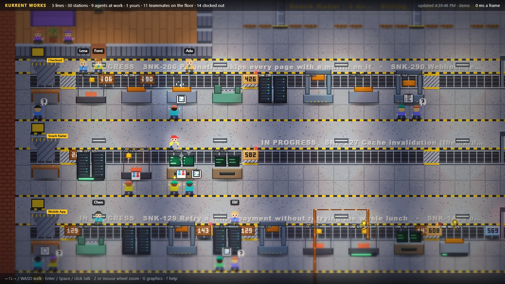
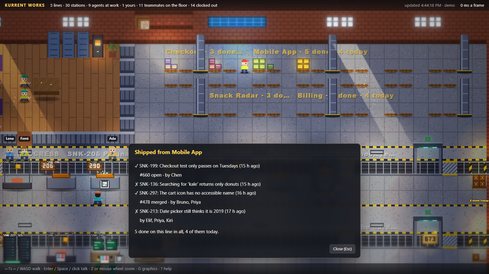

# kcap-factory

Walk a pixel-art factory floor built from the coding-agent sessions your team records with
[KCap](https://github.com/kurrent-io/kcap-cli) (Kurrent Capacitor), right in your browser.



| On the floor | In KCap |
|---|---|
| A production line | A project (or a repo standing alone) |
| A workstation on the line | An issue being worked on |
| A worker in a hard hat | A running agent session; the hat is its vendor, a gold marker means it's yours |
| A worker in the break room | An agent session that has gone idle |
| A person with a name tag | A teammate whose agents you can see |
| Crates and boxes on the belt | Issues riding to their station, pull requests heading to review |
| The QA gate | PRs waiting for review: amber waiting, green approved, red failing or sent back |
| Pallets in the shipping yard | Work that shipped or closed, line by line |
| The job board | Your next-work feed |

Walk up to anything and talk to it: an agent tells you whose it is, what it is on, its plan, its
pull requests and what it has been doing; a teammate tells you what their agents are up to; a
pallet lists what shipped.



## Prerequisites

1. **KCap, installed and signed in.** The factory reads everything through the `kcap` CLI and
   its stored login, so set that up first:

   ```sh
   npm install -g @kurrent/kcap
   kcap setup
   ```

   See the [kcap-cli README](https://github.com/kurrent-io/kcap-cli#readme) for details. Check it
   works with `kcap sessions --json`.
2. **Node.js 22** or later.

## Run it

```sh
npm install
npm start
```

`npm start` serves the game on `127.0.0.1` and opens it in your browser. The link carries a
one-off key in its `#` fragment; keep the terminal open while you play and press Ctrl+C to stop.

No KCap yet? `npm run demo` lays out an invented floor (a snack-delivery startup's backlog) with
no network at all.

## Controls

| Key | Does |
|---|---|
| Arrows / WASD | Walk |
| Enter / Space / click | Talk to what is in front of you (facing a belt reaches across it) |
| Z, + / -, mouse wheel | Zoom |
| G | Lighting and lens effects on or off |
| ? | How the factory works |
| Esc | Close a dialog |

## What it reads

The factory is read-only: it never writes to KCap, GitHub or your tracker. It uses your own KCap
login, so it shows exactly the sessions you are allowed to see and nothing else:

- `kcap sessions --json`: the sessions you can see. This listing is the only source of workers;
  everything else is read through a session it returned.
- `GET /api/work-items/…`: the issue each session is on, its plan and blockers.
- `GET /api/sessions/{id}/pull-requests`: a session's pull requests and their state.
- `GET /api/projects`: which repos make up each line.
- `GET /api/next-work`: the job board.

It never reads prompts, file paths or PR descriptions, and a refused read leaves its item off the
floor rather than guessing.

## Development

```sh
npm run check      # type-check the server and the browser code, then run the tests
npm test           # tests only
```

`dev/` holds tools for working on the renderer: `preview.mts` renders a floor to a PNG,
`ascii.mts` prints its layout, and `survey-live.mts` dumps what your KCap login sees as JSON.
